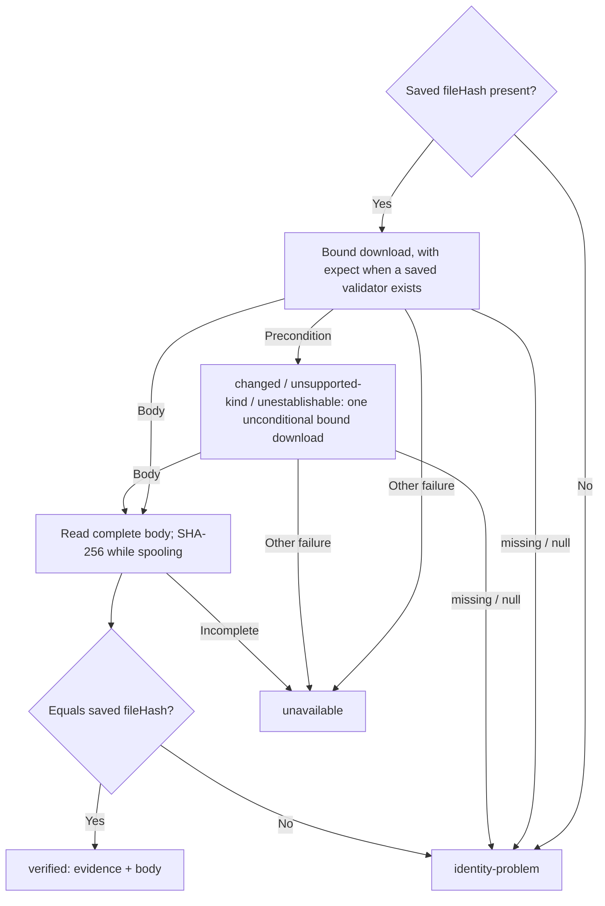

# Extraction contracts — specification

Companions:

- [Implementation plan](./2026-10-31-extraction-contracts-plan.md) — stages, checkpoints and checks. Section numbers there refer to this document.
- [Track roadmap](./2026-10-31-extraction-retrieval-track-roadmap.md) — Phase 4 of the extraction, retrieval and agent-access track, now scheduled next.
- [Stored-file content identity specification](./2026-10-31-stored-file-identity-spec.md) — the shipped 6.12.0 baseline this work consumes: `fileHash`, `storageValidator`, `download` and `head`.
- [Attachment extraction for search](../docs/06-search/07-attachment-extraction.md) — the current planning page, which this phase rewrites.
- Issue #5 — the tracking issue. Issue #108 (upload receipts) is related but not a prerequisite.

**Status:** revision 3, accepted by Tony on 2026-10-31 with all eight §14
decisions. A completing clarification (same day, no decision reopened)
adds the deployment identifier to the work decision's producer input, with
`buildExtractionProducer` keeping it consistent with the hash (§5.7, §6.6). Revision 2
closed three review findings: failed eligibility updates (§7), the provider
version before reuse (§5.10) and evidence compatibility (§6.4). Revision 3
separates a host-configured deployment identifier from the engine version
(§5.7, §5.10) and limits version-equality conformance to a stable engine. No implementation has
started; branch `feat/extraction-contracts-5` has no changes beyond `e3075ca9`
(v6.12.0).

## 1. Purpose

Attachment extraction turns a stored file, such as a PDF, into text and
structure that search, retrieval and agents can use. Read this specification
when you are writing an extraction provider, wiring extraction into a
collection, or deciding whether extracted text may be shown in search.

A downstream research library extracts PDF text through an out-of-process
Apache Tika service and joins it into search. It keeps its provider contract
in a host package and wants to import it from Byline instead. Its design work
also showed that the contract is not only a provider interface. A successful
extraction is not, by itself, permission to publish its output: the bytes may
not be the file the document records, the document may have changed while the
extractor ran, and a failed search write may leave old text visible. This
specification therefore covers three things:

1. **Provider contracts.** Types, typed failures, capabilities, the artifact
   shape and page map version 1. Providers stay pure `bytes → output`
   drivers.
2. **Generic guarantees Byline implements now.** A verified source read that
   binds the bytes passed to an extractor to their hash and validator, a
   reuse probe, an evidence validator and a work decision. These are small,
   pure or storage-level, and testable against the existing storage
   conformance providers.
3. **Lifecycle semantics Byline specifies now and implements later.** Saved
   versus derived versus projected outcomes, retention versus eligibility,
   promotion fencing, projection repair and legacy migration. These are
   normative for any later Byline store or orchestration, and describe what a
   host must implement until then.

The artifact store, attempts and selection tables, the search join, the
worker, the router and the admin log are not part of this release (§11).

## 2. Vocabulary

**Extraction provider.** A driver that accepts file bytes and hints and
returns an `ExtractionResult`, or rejects with a typed error. Examples:
Tika, Docling, an OCR service, a hosted vision model. It never reads CMS
documents, storage, search or access state.

**Orchestration.** The code around a provider: it decides whether work is
required, reads and verifies the source, calls the provider, records
attempts and artifacts, promotes a selection and updates search. Today a
host writes it. Byline supplies building blocks (§6) and specifies the
semantics (§7–§9).

**Expected identity.** The saved `StoredFileValue.fileHash` and
`storageValidator` of the attachment reference — what the document records.
The saved envelope is client-submitted today (issue #108 proposes receipts).

**Observed identity.** The SHA-256 of the complete bytes a read actually
returned, and the validator the provider returned with those bytes.

**Verified read.** A complete read whose observed hash equals the expected
`fileHash`. Only verified bytes reach an extractor.

**Verification evidence.** The record that binds an extraction to a verified
read: expected hash, observed hash, bound validator and time (§6.4). A hash
copied from the envelope is not evidence.

**Artifact.** One successful extraction output with its source content hash
and producer identity. Artifacts are immutable and may be shared by several
references that resolve to identical bytes and the same producer.

**Attempt.** One execution of a provider for a source, successful or not.

**Reference.** The association between a document (and version), a stored
file path and a purpose, such as search. Selection, eligibility and access
belong to the reference, not the artifact.

**Promotion.** Making an artifact the selected output of a reference.

**Projection.** What a search provider holds for a document. A projection is
*pending* when Byline or the host knows it does not yet reflect the current
eligible selection.

**Identity problem.** The stored object cannot be confirmed to be the file
the document records: `missing-hash`, `missing-object` or `hash-mismatch`.

## 3. Current state (verified against `e3075ca9`)

- `@byline/core` has no extraction types. `docs/06-search/07-attachment-extraction.md`
  describes a planned boundary with an illustrative `ExtractionArtifact` that
  differs from the downstream prototype.
- 6.12.0 shipped the storage baseline: upload computes `fileHash`;
  `IStorageProvider.download?(path, { expect?, signal? })` returns a
  `StoredObjectRead` whose `validator` belongs to the bytes in `body`;
  `head?(path)` is a probe only; `ERR_STORAGE_PRECONDITION` carries
  `details.reason` of `changed`, `unsupported-kind`, `unestablishable` or
  `missing`. `StoredObjectRead.body` is a `NodeJS.ReadableStream`.
- `@byline/core/stored-files` (server-only) exports `hashStream`,
  `uploadWithContentHash` and `backfillStoredFileIdentity`. The root entry
  must stay free of `node:` imports; it hashes with WebCrypto
  (`sha256Hex`).
- The downstream prototype contract (`extractor-types.ts`) defines
  `ExtractionProvider`, `ExtractionInput`, `ExtractionResult`,
  `ExtractionMetadata`, `RoutingSignals`, `ExtractorCapabilities`,
  `ExtractionProviderError` (`failureScope`, `retryable`) and
  `isFileExtractionFailure`. It imports `ReadableStream` from
  `node:stream/web` and accepts `Buffer`.
- The downstream library has implemented a host-side verified read with the
  fallback policy in §6.2 and the evidence record in §6.4. This
  specification generalises it.
- `@byline/storage-conformance` (private) runs against `storage-local` and
  `storage-s3` (RustFS in CI). `@byline/search-conformance` is private.

## 4. Responsibilities

| Boundary | Owns | Does not own |
|---|---|---|
| Upload and saved file | Upload hash, storage location and validator, future receipt validation | Extracted output, selection |
| Storage provider | Bound reads, probes, capability and precondition errors | Deciding which file an editor intended |
| Orchestration | Expected versus observed identity, hashing the bytes passed to the provider, the reuse decision, attempts, reporting | Changing the saved envelope to match an unexpected object |
| Extraction provider | Parsing and OCR of supplied bytes; output, capabilities, typed failures | Document revisions, access, storage repair, search writes |
| Artifact and reference layer | Immutable output with producer provenance; references; selection per purpose; promotion preconditions | Treating a failed attempt as replacement text |
| Search and retrieval | Projecting only eligible selections; projection repair state; read-time exclusion where required | Extracting files during a plain reindex |
| Host and admin | Triggers, notification, explicit reconciliation, access and operational policy | Inferring editorial intent from hash equality |

Hashing is an orchestration duty. A provider need not compute a duplicate
hash. Byline's verified read (§6.2) does it once, before the provider sees
any bytes.

## 5. Provider contract

All types in this section are exported from the `@byline/core` root entry,
which stays browser-safe. They are **provisional**: until the contract is
declared stable, a minor release may change them, and the changelog will say
so. `ExtractionArtifact.schemaVersion` and `PageMapV1.version` version the
persisted shapes independently of the package version (§5.9).

### 5.1 `ExtractionProvider`

```ts
export interface ExtractionProvider {
  /** Stable driver identifier, recorded on every result, e.g. 'tika'. */
  readonly name: string
  /** What the driver supports. Consumers gate on it; never assumed. */
  readonly capabilities: ExtractorCapabilities
  /**
   * Effective output-affecting configuration, as JSON. Included in the
   * producer configuration hash (§5.7). Omit secrets and endpoints.
   */
  readonly configuration?: Readonly<Record<string, JsonValue>>
  /** Hints from `ExtractionHints` that change this driver's output (§5.7). */
  readonly outputAffectingHints?: readonly ExtractionHintName[]
  /**
   * The engine version that `extract` would report now, without extracting.
   * A local driver returns a constant; a remote driver asks its service
   * (Tika's `/version`). Rejects with an `infrastructure` error when the
   * service cannot answer. See §5.10.
   */
  resolveVersion?(options?: { signal?: AbortSignal }): Promise<string>
  /** Extract one file. Rejects with `ExtractionProviderError` on failure. */
  extract(input: ExtractionInput): Promise<ExtractionResult>
  /** Boot-time health check for a remote service. */
  ping?(): Promise<void>
}
```

A provider must not read Byline documents, storage or search, persist
anything, or decide eligibility. A future router is itself an
`ExtractionProvider` that composes drivers.

### 5.2 `ExtractorCapabilities`

```ts
export interface ExtractorCapabilities {
  ocr: boolean          // recognises text on image-only pages
  markdown: boolean     // emits structure-aware markdown
  tables: boolean       // reconstructs table structure
  formulas: boolean     // recognises formulas
  charts: boolean       // attempts figure and chart understanding
  coordinates: boolean  // reports block positions or reading order
  pageMap: boolean      // emits a page map v1 from a page-aware assembly (§5.8)
  structure: boolean    // emits provider-native `structure`
  formats: string[]     // accepted MIME types; '*/*' or 'type/*' wildcards
}
```

`pageMap` and `structure` are new relative to the prototype. They make the
optional result members honest: a provider that declares `false` must not
emit the member, and the conformance kit checks both directions (§10.1).

### 5.3 `ExtractionInput` and hints

```ts
export interface ExtractionHints {
  filename?: string       // extension is a parser-selection hint
  mimeType?: string       // declared type; a parser-selection hint
  language?: string       // BCP 47; OCR model selection
  ocrLanguages?: string[] // explicit OCR language list, when it differs
}

export type ExtractionHintName = keyof ExtractionHints

export interface ExtractionInput extends ExtractionHints {
  /** Verified source bytes: a web stream for large files, or a byte array. */
  data: ReadableStream<Uint8Array> | Uint8Array
  /** Abort the extraction. The provider releases its resources. */
  signal?: AbortSignal
}
```

`ReadableStream` is the global web stream type, not `node:stream/web`, so the
root entry needs no `node:` import. `Buffer` is a `Uint8Array` subclass and
is still accepted. A provider must consume the stream to its end or cancel
it; the caller owns any spool behind it (§6.3).

### 5.4 `ExtractionResult` and `ExtractionMetadata`

```ts
export interface ExtractionResult {
  provider: string              // equals ExtractionProvider.name
  providerVersion?: string      // engine version as reported at run time
  plainText: string             // always present; '' when nothing extractable
  markdown?: string             // only when capabilities.markdown
  structure?: JsonValue         // provider-native, opaque, only when capabilities.structure
  pageMap?: PageMapV1           // only when capabilities.pageMap (§5.8)
  pageCount?: number            // physical pages, when the format has pages
  metadata: ExtractionMetadata
  signals: RoutingSignals
}

export interface ExtractionMetadata {
  contentType?: string  // detected MIME type
  pages?: number        // as reported by the file's metadata
  title?: string
  authors?: string[]
  language?: string     // declared or detected, as embedded
  createdAt?: string    // ISO 8601
  producer?: string     // producing application
}
```

`providerVersion` is new. The engine version can change while the process
runs (a Tika server is upgraded), so the result records the version that
actually produced it. When a provider cannot report it, it is absent;
orchestration records the version resolved for the run, or `null`
(§5.10), and never invents one. A provider that
implements `resolveVersion` must report the same value on its results; the
conformance kit checks this (§10.1). How the version is known *before*
extracting is §5.10.

`pageCount` is the physical page count used by page maps.
`metadata.pages` keeps the prototype's meaning (what the file declares) and
may disagree; consumers prefer `pageCount`.

### 5.5 `RoutingSignals`

Unchanged from the prototype: `totalChars`, optional `charsPerPage`,
`ocrCandidatePages` and `textLayerCoverage` (0–1). They are cheap
classification inputs for a router. They are not page boundaries:
`charsPerPage` must never be used to derive page-map offsets, because it is
counted over text that is normalised afterwards.

### 5.6 Typed failures

```ts
export type ExtractionFailureScope = 'file' | 'infrastructure'

export class ExtractionProviderError extends Error {
  readonly code: 'ERR_EXTRACTION_PROVIDER'
  readonly failureScope: ExtractionFailureScope
  readonly retryable: boolean
  constructor(message: string, options: {
    failureScope: ExtractionFailureScope
    retryable: boolean
    cause?: unknown
  })
}

export function isExtractionProviderError(error: unknown): error is ExtractionProviderError
export function isFileExtractionFailure(error: unknown): error is ExtractionProviderError
```

- `file`: the input caused the failure (corrupt, encrypted, unsupported
  format). Orchestration may record a per-file failure for this source and
  producer.
- `infrastructure`: the service failed (timeout, unavailable, bad
  credentials, misconfiguration). Orchestration must not record the file as
  bad and must preserve existing artifacts.
- `retryable` is independent policy: bad credentials are `infrastructure`
  but not usefully retryable until repaired.
- **An untyped error, or an abort, is never a file failure.**
  `isFileExtractionFailure` returns `true` only for a typed `file` error.
- The guards use the `code` brand as well as `instanceof`, so an error
  thrown by a second copy of `@byline/core` still classifies. This is a
  deliberate deviation from the prototype's `instanceof`-only check.

Provider failures describe the provider call only. Source outcomes (§6) and
post-extraction outcomes (§7) have their own vocabularies; do not fold them
into `failureScope`.

### 5.7 Producer identity and the configuration hash

The same bytes can produce different output under a different engine,
version or setting. An artifact is therefore identified by its source
content hash **and** its producer:

```ts
export async function producerConfigHash(input: {
  provider: string
  configuration?: Record<string, JsonValue>
  hints?: ExtractionHints              // only the provider's outputAffectingHints are kept
  outputAffectingHints?: readonly ExtractionHintName[]
  configurationVersion?: string        // a host-chosen policy version
  deploymentIdentifier?: string | null // a host-controlled engine deployment id (§5.10)
}): Promise<string>                    // SHA-256 lower-case hex
```

The hash covers canonical JSON (sorted keys, no insignificant whitespace,
`undefined` members dropped, non-JSON values rejected) of the provider name,
configuration, the output-affecting hints that were supplied, the
configuration version and the deployment identifier. The engine version the
provider reports is recorded beside it as `providerVersion`, not inside it,
so an engine change is visible as its own reuse reason. A deployment
identifier is a different value — what the host deployed, not what the
engine reports — and is therefore part of the hash (§5.10).

`deploymentIdentifier`, when given, must be a non-empty string with no
leading or trailing whitespace; `producerConfigHash` rejects any other
value with a `TypeError` rather than hashing it. An absent identifier and
`null` are the same: no identifier.

Orchestration builds the producer for a run once, so that the hash and the
work decision (§6.6) are computed from the same values:

```ts
export interface ExtractionProducerIdentity {
  provider: string
  providerVersion: string | null       // current engine version (§5.10)
  producerConfigHash: string
  deploymentIdentifier: string | null  // exactly the value hashed into producerConfigHash
}

export async function buildExtractionProducer(input: {
  provider: ExtractionProvider
  providerVersion: string | null       // from resolveVersion, or null
  hints?: ExtractionHints
  configurationVersion?: string
  deploymentIdentifier?: string | null
}): Promise<ExtractionProducerIdentity>
```

`buildExtractionProducer` calls `producerConfigHash` with the provider's
`name`, `configuration` and `outputAffectingHints` and the given values,
and returns the identifier it hashed. It is the recommended way to obtain
a producer. A
provider that ignores a hint omits it from `outputAffectingHints` and says so
in its documentation.

### 5.8 Page map version 1 (provisional)

A page map locates each physical page of a paginated source within
`plainText`. It is **provisional and evidence-based**: Byline validates its
structure, but structural validity is not proof that the boundaries are
correct.

```ts
export interface PageMapV1 {
  version: 1
  assembly: {
    pageSeparator: string            // inserted between consecutive ranges
    trailing?: 'embedded' | 'none'   // what follows the last page
  }
  pages: Array<{ index: number; label?: string; charStart: number; charEnd: number }>
  unanchored?: Array<{ kind: string; charStart: number; charEnd: number }>
  blocks?: Array<{ page: number; charStart: number; charEnd: number; kind: string }>
}
```

Production rule: a provider emits a page map only from a page-aware path
that obtains per-page text and assembles `plainText` from it, so offsets are
computed against the exact stored string. Offsets are UTF-16 code-unit
indices into `plainText`, half-open (`charStart` inclusive, `charEnd`
exclusive).

`validatePageMap(plainText, map, { pageCount? })` returns
`{ ok: true } | { ok: false; issues: PageMapIssue[] }` and checks:

1. `version === 1`; `pageSeparator` is a string.
2. Every offset is an integer with `0 ≤ charStart ≤ charEnd ≤ plainText.length`.
3. No range boundary splits a UTF-16 surrogate pair.
4. `pages[].index` is a positive integer and strictly increasing. When
   `pageCount` is given, the indexes are exactly `1…pageCount`. An empty page
   is a zero-length range, not a missing entry.
5. Page ranges are ordered and do not overlap.
6. Between two consecutive ranges in text order (pages and unanchored
   ranges together), the text is exactly `pageSeparator`; that gap belongs to
   no range.
7. Before the first range and after the last range there is no text.
   Coverage is therefore complete: every code unit is in a page, a separator
   gap or an unanchored range.
8. Unanchored ranges do not overlap pages or each other. With
   `trailing: 'embedded'` they follow the last page; with `'none'` or absent,
   there are none after the last page.
9. Each block lies inside the range of the page it names; blocks of a page
   do not overlap.

Rules 6 and 7 make coverage checkable. Coverage still does not prove that
page 3's text came from physical page 3; only sentinel verification against
a fixture does (§10.1). Consumers display a provider's map; a provider that
cannot produce pages emits none.

### 5.9 `ExtractionArtifact`

The persisted shape an orchestration layer builds from a result and a
verified read:

```ts
export interface ExtractionArtifact {
  schemaVersion: 1
  contentHash: string | null        // source bytes; null only for legacy imports (§9)
  sourceVerified: boolean           // true exactly when contentHash came from a verified read
  provider: string
  providerVersion: string | null
  producerConfigHash: string
  plainText: string
  markdown?: string
  structure?: JsonValue
  pageMap?: PageMapV1
  pageCount?: number
  metadata: ExtractionMetadata
  signals: RoutingSignals
  producedAt: string                // ISO 8601
}
```

The field names follow the downstream library's artifact table so its store
can import the type unchanged. Document, version, path, access and selection
are deliberately absent: they belong to references, so one artifact can
serve every authorised reference to the same bytes and producer.
`validateExtractionArtifact()` checks the shape, `contentHash` format,
`sourceVerified === (contentHash !== null)`, and the page map (§5.8).

Neither `contentHash` nor the stored file's `fileHash` is a hash of
extracted text. An output digest is not part of this contract.

Versioning: `schemaVersion` increments when a persisted member changes
meaning or becomes required. A reader that meets an unknown
`schemaVersion` treats the artifact as unusable for reuse (a
`schema-changed` work reason, §6.6), never as malformed source data.

### 5.10 Knowing the producer before reuse

The work decision (§6.6) compares the current producer with the artifact's
producer before it decides whether to extract, so the current producer must
be known without extracting. Two independent values can identify the
engine, and they are persisted and compared separately:

- **Engine version** (`providerVersion`). What the engine itself reports.
  Persisted on the artifact; compared by the table below.
- **Deployment identifier** (`deploymentIdentifier`). A value the host
  controls and changes when it changes the engine, such as a pinned
  container image tag. It is never written into `providerVersion`. It is an
  input to `producerConfigHash` (§5.7), so it is persisted inside the
  artifact's `producerConfigHash` and a change appears as
  `producer-changed` through the hash comparison.

**Current engine version.** Orchestration calls
`provider.resolveVersion()` once per run, or caches it for a short,
documented interval. Without `resolveVersion`, the current engine version is
`null`. Discovery failing is an `infrastructure` outcome for the run, not a
reason to re-extract.

**Recorded engine version.** The artifact records
`result.providerVersion` when the result reports one, otherwise the version
resolved for the run, otherwise `null`. A result's own version wins because
it is what produced the output (see the mid-run case below).

**Comparison.**

| Current engine version | Artifact's recorded version | Outcome |
|---|---|---|
| Known | Equal | No version reason |
| Known | Different | `producer-changed` |
| Known | `null` (recorded before versions were known) | `producer-changed`, once: the new artifact records the resolved version, so the next decision finds them equal |
| `null` | Any | No version reason |

`versionUnchecked` is `true` exactly when the current engine version is
`null` **and** the producer's `deploymentIdentifier` is `null`. The
decision reads the identifier from the producer input (§6.6); by the
consistency rule there, that is the identifier hashed into
`producerConfigHash`. It is reduced assurance, like an `unprobed` source
(§6.5): reuse proceeds, and an engine upgrade is not detected. A caller
reports it, and detects upgrades by configuring a deployment identifier or
running a forced pass after an upgrade. When a deployment identifier is
configured, an engine upgrade is detected through the hash as long as the
host changes the identifier, so `versionUnchecked` is `false`.

These rules cannot cause repeated extraction. A `null` current version
never yields a version reason. When the current version is known, the
artifact records that version (or the result's own), so the next decision
compares equal. A host-supplied identifier never sits in `providerVersion`,
so it is never compared with an engine-reported value. A caller never
copies the artifact's recorded version into the current version, which
would hide an upgrade.

**Mid-run upgrade.** When the result reports a version different from the
one resolved for the run (the engine changed while the run was in
progress), the artifact records the result's version, which is the engine's
real version. This is accepted, not an error. The next run resolves the new
version and finds it equal, so there is no further work. Conformance case 9
does not test this case; it assumes a stable engine (§10.1).

## 6. Generic guarantees Byline implements in this release

These are server-only and exported from `@byline/core/stored-files`, except
the evidence validator and the work decision, which are pure and exported
from the root. Each is a guarantee with its own conformance cases (§10.2).

### 6.1 Outcomes of a source read

```ts
export type SourceIdentityProblem = 'missing-hash' | 'missing-object' | 'hash-mismatch'
export type SourceUnavailableReason =
  | 'download-unsupported'  // provider has no download()
  | 'provider-mismatch'     // value stored by a different provider than the one configured
  | 'read-failed'           // network, credentials, service, or a body that ended early
  | 'aborted'
export type PreconditionFallbackReason = 'changed' | 'unsupported-kind' | 'unestablishable'

export type VerifiedSourceRead =
  | { status: 'verified'; evidence: SourceVerificationEvidence; body: VerifiedSourceBody }
  | {
      status: 'identity-problem'
      problem: SourceIdentityProblem
      storagePath: string
      expectedHash?: string                 // absent for missing-hash
      observedHash?: string                 // only for hash-mismatch
      observedValidator?: StorageValidator  // only for hash-mismatch
      preconditionFallback?: PreconditionFallbackReason
    }
  | { status: 'unavailable'; reason: SourceUnavailableReason; cause?: unknown }
```

The helper returns outcomes rather than throwing them, so a caller handles
each case explicitly. It never invents an observed hash: a precondition that
prevented reading yields no `observedHash`.

### 6.2 `readVerifiedSource`

```ts
export async function readVerifiedSource(
  storage: IStorageProvider,
  source: Pick<StoredFileValue, 'storagePath' | 'storageProvider' | 'fileHash' | 'storageValidator'>,
  options?: {
    /** Skip the expectation: a probe already showed a different validator. */
    knownChanged?: boolean
    signal?: AbortSignal
    /** Bytes kept in memory before spooling to a temporary file. Default 8 MiB. */
    memoryThreshold?: number
  }
): Promise<VerifiedSourceRead>
```

Normative behaviour:

1. No `fileHash` → `identity-problem: missing-hash`, **without any read**.
   Absent and empty are the same; an empty string is never a hash.
2. `source.storageProvider !== storage.providerName` →
   `unavailable: provider-mismatch`. No `download` → `unavailable:
   download-unsupported`.
3. First read: `download(path, { expect: source.storageValidator, signal })`,
   or without `expect` when the reference has no validator or `knownChanged`
   is set.
4. `ERR_STORAGE_PRECONDITION` with reason `missing`, or a `null` result →
   `identity-problem: missing-object`.
5. `ERR_STORAGE_PRECONDITION` with `changed`, `unsupported-kind` or
   `unestablishable` → **exactly one** unconditional bound `download`. A
   precondition error with an unrecognised reason is treated as
   `unestablishable`. A changed token does not prove changed content; the
   hash decides. The reason is kept in the outcome. A second precondition or
   `null` on the fallback follows rule 4 or rule 6; there is never a third
   read.
6. Any other error on either read → `unavailable: read-failed` (or
   `aborted` when the signal fired), with the original error as `cause`.
7. The body is read **to its end** and hashed while it is spooled (§6.3).
   An early end, a stream error or an abort → `unavailable` and the spool is
   deleted. No partial body is ever exposed.
8. Observed hash ≠ `fileHash` → `identity-problem: hash-mismatch` with
   `expectedHash`, `observedHash`, `observedValidator` (the validator returned
   with those bytes) and any fallback reason. The spool is deleted. Nothing is
   extracted.
9. Observed hash = `fileHash` → `verified`, with evidence whose `validator` is
   the one returned by **this** read, never a validator from an earlier probe
   or from the saved envelope.
10. The helper never writes to storage, never changes the saved
    `StoredFileValue`, and never accepts different bytes because a caller
    asked for force. Force is a work decision (§6.6), not a verification
    bypass.



### 6.3 `VerifiedSourceBody`

```ts
export interface VerifiedSourceBody {
  readonly size: number
  /** A fresh web stream over the verified bytes; may be opened more than once. */
  stream(): ReadableStream<Uint8Array>
  /** The verified bytes in memory. Avoid for large files. */
  bytes(): Promise<Uint8Array>
  /** Delete any spool file. Idempotent. */
  dispose(): Promise<void>
}
```

Bodies up to `memoryThreshold` stay in memory; larger bodies are spooled to a
private temporary file (mode `0600`) while hashing, so a 100 MB PDF is
verified before extraction without holding it in memory. Extraction starts
only after verification, which closes the "streaming result promoted before
the hash completed" failure by construction. The caller disposes of the
body in a `finally` block. (`Symbol.asyncDispose` is not used: the Node
floor, 22.22, predates `await using`.) The downstream prototype buffered whole files;
spooling is the generalisation (decision 3).

### 6.4 Verification evidence

```ts
export interface SourceVerificationEvidence {
  expectedHash: string        // the reference's fileHash at read time
  contentHash: string         // SHA-256 measured from the bytes read; equals expectedHash
  validator: StorageValidator // returned with those bytes
  verifiedAt: string          // ISO 8601
  size?: number
  readBasis?: 'expected' | 'unconditional' | 'fallback'
  preconditionFallback?: PreconditionFallbackReason // see the compatibility rules below
}

export function isSourceVerificationEvidence(
  value: unknown,
  options?: { expectedHash?: string }
): value is SourceVerificationEvidence
```

The first five members match the downstream library's
`metadata.contentIdentity` record, so evidence it has already written
validates. `readBasis` is new and optional: `expected` (the saved validator
was established), `unconditional` (no saved validator, or a probe showed a
change) or `fallback`.

The validator accepts a record only when every rule holds:

1. `value` is a plain object. Unknown extra members are ignored, so a later
   minor can add members without invalidating stored evidence.
2. `expectedHash` and `contentHash` match the content-hash pattern and are
   equal. `expectedHash` equals `options.expectedHash` when it is given.
3. `validator` is an object with string `kind` and `value` within
   `STORAGE_VALIDATOR_LIMITS`.
4. `verifiedAt` is a string that parses as an ISO 8601 date-time.
5. `size`, when present, is a non-negative safe integer.
6. `readBasis`, when present, is `expected`, `unconditional` or `fallback`.
7. `preconditionFallback`, when present, is `changed`, `unsupported-kind` or
   `unestablishable`.
8. The relationship between the two:

   | `readBasis` | `preconditionFallback` | Valid |
   |---|---|---|
   | absent | absent or any reason | Yes — legacy records written before `readBasis` existed |
   | `fallback` | a reason | Yes |
   | `fallback` | absent | No |
   | `expected` or `unconditional` | absent | Yes |
   | `expected` or `unconditional` | a reason | No |

A legacy record with a fallback reason and no `readBasis` is read as a
fallback read; one with neither has an unknown read basis, which does not
affect its validity. `readVerifiedSource` always writes `readBasis`, and
`size` whenever it read a body.

The presence of a JSON key is not evidence. Evidence is a statement about
one read at one time; it is not continuous storage monitoring.

### 6.5 `probeVerifiedSource`

```ts
export type SourceProbe =
  | { status: 'unchanged'; validator: StorageValidator }
  | { status: 'changed'; validator: StorageValidator }  // read required, with knownChanged
  | { status: 'missing-object' }
  | { status: 'unprobed'; reason: 'head-unsupported' | 'no-evidence' }
  | { status: 'unavailable'; cause: unknown }

export async function probeVerifiedSource(
  storage: IStorageProvider,
  storagePath: string,
  evidence: SourceVerificationEvidence | null
): Promise<SourceProbe>
```

- The probe compares `head()` with the **evidence's** validator through
  `isSameStorageValidator`, never with the reference's saved validator. A
  matching copied value therefore cannot stand in for verification.
- A different validator, or one of a different kind, is `changed`: the
  caller reads with `knownChanged`, and the hash decides.
- `unprobed` is **reduced assurance**, not `unchanged`. With `head-unsupported`
  a caller may reuse a verified artifact without a probe, but must document
  that only separate verify runs (`backfillStoredFileIdentity` in `verify`
  mode) detect a same-path replacement. With `no-evidence`, reuse is not
  permitted at all; the work decision returns `unverified`.
- An unchanged probe does not establish a first baseline and does not prove
  the object cannot change afterwards.

### 6.6 `decideExtractionWork`

```ts
export type ExtractionWorkReason =
  | 'force'
  | 'no-artifact'                    // nothing usable exists for this reference and producer
  | 'previous-attempt-unsuccessful'  // last attempt failed or hit an identity problem
  | 'source-changed'                 // reference fileHash differs from the artifact's contentHash
  | 'unverified'                     // no valid evidence for the current hash
  | 'producer-changed'               // provider, version or configuration hash differs
  | 'schema-changed'                 // artifact schemaVersion is not the current one

export type ExtractionWorkDecision =
  | { kind: 'identity-problem'; problem: 'missing-hash' }
  | { kind: 'work'; reasons: ExtractionWorkReason[]; versionUnchecked: boolean }
  | { kind: 'reuse'; evidence: SourceVerificationEvidence; versionUnchecked: boolean }

export function decideExtractionWork(input: {
  force?: boolean
  reference: { fileHash?: string | null }
  /** Built by `buildExtractionProducer` (§5.7); see the consistency rule below. */
  producer: ExtractionProducerIdentity
  existing?: {
    state: 'complete' | 'failed' | 'identity-problem'
    artifact?: Pick<ExtractionArtifact, 'contentHash' | 'sourceVerified' | 'provider'
      | 'providerVersion' | 'producerConfigHash' | 'schemaVersion'>
    evidence?: unknown
  } | null
}): ExtractionWorkDecision
```

- **Producer consistency.** `producer.deploymentIdentifier` must be the
  value that was hashed into `producer.producerConfigHash` — the same
  string, or `null` when none was hashed. `buildExtractionProducer`
  guarantees this by construction. A caller that assembles the producer by
  hand must pass the identical value to `producerConfigHash`; the decision
  is synchronous and cannot recompute the hash, so it trusts the field. It
  validates the field's form (a non-empty trimmed string or `null`) and
  throws a `TypeError` otherwise. An inconsistent hand-built producer is a
  caller bug: it misreports `versionUnchecked`, and the hash comparison
  still governs reuse.
- **Unknown engine version.** With `producer.providerVersion === null`, the
  decision returns `versionUnchecked: true` when
  `producer.deploymentIdentifier` is `null`, and `false` when it is set
  (an engine change is then detected through the hash, provided the host
  changes the identifier). With a known engine version,
  `versionUnchecked` is always `false`.
- A reference without `fileHash` is an identity problem, not a work reason.
- `force` always yields `work` and is reported with any other reasons. Force
  bypasses reuse; it never bypasses the verified read.
- `reuse` requires a `complete` existing state, a `sourceVerified` artifact
  whose `contentHash` equals the reference's `fileHash`, valid evidence for
  that hash (§6.4), the same provider and configuration hash, a version that
  passes §5.10, and the current schema version. A
  legacy artifact (`contentHash: null`) is never reused as verified.
- A `reuse` decision is followed by `probeVerifiedSource`; `changed` turns it
  into a read with `knownChanged`.
- Hosts may add their own reasons (for example an inspection-policy
  version) and treat the union as the decision.

## 7. Lifecycle semantics: three independent outcomes

A save, an extraction and a search update are three separate facts. One
`success` flag cannot report them, and a hook that runs after commit cannot
undo a save by throwing.

1. **Editorial persistence.** Was the document saved, and which version was
   committed? Byline's document lifecycle already reports this.
2. **Derivation.** Was the source verified, and was extraction reused,
   completed, unavailable, blocked or refused?
3. **Projection.** Does search reflect the current eligible selection, or is
   repair pending?

Between derivation and projection sits one more fact that must not be
inferred: whether the **eligibility update** was recorded. When a
derivation makes previously eligible text ineligible (an identity problem,
for example), orchestration must durably record that before a projection
write can omit the text. If recording fails, a projection write that
succeeds still joins the old text, so a successful write is not exclusion.

This release exports the reporting vocabulary as provisional types so hosts
and later Byline layers report the same facts:

```ts
export type PromotionRefusalReason =
  | 'hash-changed' | 'version-changed' | 'access-changed' | 'artifact-mismatch' | 'claim-lost'

export type DerivationOutcome =
  | { kind: 'reused' }
  | { kind: 'extracted' }
  | { kind: 'identity-problem'; problem: SourceIdentityProblem }
  | { kind: 'source-unavailable'; reason: SourceUnavailableReason }
  | { kind: 'provider-failed'; failureScope: ExtractionFailureScope; retryable: boolean }
  | { kind: 'promotion-refused'; reason: PromotionRefusalReason }

export type EligibilityUpdateOutcome =
  | { kind: 'not-required' }   // nothing previously eligible became ineligible
  | { kind: 'recorded' }       // ineligibility durably recorded
  | { kind: 'failed' }         // recording failed; the join still includes the old text

export type ProjectionOutcome =
  | { kind: 'written' }     // the provider acknowledged the write
  | { kind: 'pending'; reason: 'write-failed' | 'not-attempted' | 'stale-write' }

export type ExclusionState =
  | { state: 'not-required' }
  | { state: 'excluded' }   // eventual level only (§8.2); see the rule below
  | {
      state: 'pending'
      reason: 'eligibility-update-failed' | 'write-failed' | 'not-attempted' | 'stale-write'
    }

export interface AttachmentProcessingReport {
  documentId: string
  documentVersionId?: string
  storagePath: string
  runId?: string
  derivation: DerivationOutcome
  eligibility?: EligibilityUpdateOutcome
  projection?: ProjectionOutcome
  exclusion?: ExclusionState
}

/** Derives the exclusion state; reporting surfaces must not compute it any other way. */
export function exclusionState(
  eligibility: EligibilityUpdateOutcome,
  projection: ProjectionOutcome | undefined
): ExclusionState
```

`exclusionState` is a pure function exported from the root. `projection` is
the outcome of the first write attempted **after** the eligibility update.
Its rule:

| Eligibility update | Projection after it | Exclusion state |
|---|---|---|
| `not-required` | any | `not-required` |
| `failed` | any, **including `written`** | `pending: eligibility-update-failed` |
| `recorded` | `written` | `excluded` |
| `recorded` | `pending` (reason *r*) | `pending: r` |
| `recorded` | none attempted | `pending: not-attempted` |

The `failed` row is the regression this rule exists for: the mark fails, the
search write succeeds, and the old text remains searchable. That case is
reported as pending, never as excluded. `excluded` means the eventual level
in §8.2 succeeded for this write; it is not the durable guarantee.

Reporting rules (normative for Byline surfaces and recommended for hosts):

- Distinguish the committed version, the derivation outcome, the
  eligibility update and the projection outcome. Include a run or
  diagnostic identifier and a per-attachment reason.
- Say "excluded" only when `exclusionState` returns `excluded`. Every
  `pending` state is reported as "exclusion pending", with its reason
  available to authorised diagnostics.
- Show expected and observed hashes and validators only where they exist and
  the viewer is authorised. Never include credentials, signed URLs or file
  contents.
- Editor messages are concise with an action link, not raw hashes. For
  example, when exclusion is pending: "Publication saved. An attachment
  could not be verified. Exclusion of its search text is pending; it may
  still appear in search." Only when exclusion succeeded: "Publication
  saved. An attachment could not be verified; its search text has been
  removed from search pending review."
- `written` means the provider acknowledged a write. It is not a durable
  exclusion guarantee (§8.2).

## 8. Retention, eligibility and search consistency

### 8.1 Retention versus eligibility

An artifact remains true evidence of the bytes it was produced from. An
identity problem, a replaced file or a restriction breaks its **eligibility**
for the current reference; it does not delete it or overwrite it with an
empty or failed record. Provider failures and storage outages preserve
existing successful artifacts. A first-ever failure leaves no text for that
source; another source's old text is never used as a fallback.

### 8.2 Two consistency levels

Removing ineligible text from search can be guaranteed at two strengths.

**Eventual exclusion with pending reporting.** When text becomes ineligible,
the next successful projection write for the document omits it. Every path
that makes text ineligible first records the eligibility update, then
attempts that write immediately, and reports the `exclusionState` (§7). A failed write leaves old text searchable until a
later successful write repairs it, and a delayed older write can briefly
restore it. This level needs no new search contract and is what a host can
build today.

**Durable read-time exclusion.** Eligibility is durable state, each
projection carries a revision, and every search request admits only
`(document id, current projection revision)` keys, so a failed or late write
cannot surface ineligible text in hits, totals, facets, snippets or future
retrieval and citations. A missing state row fails closed. This level needs
search contract features scheduled in Phase 3: string filter fields with
`$in` (including a large-list form), `where` on document id, `returnFields`
on hits, and stale-write prevention on upsert. A whole-document guard may
hide a document's metadata as well while its clean projection is pending;
metadata-only visibility is a later refinement, not a promise.

Byline documents both levels and, in this release, provides neither as
runtime behaviour. A release documents a guarantee as shipped only when it
implements it.

### 8.3 Promotion fencing (specified; implemented with the store)

Every selection change goes through one promotion operation that checks, in
the same database update: the reference's current content hash, the
document version, the access state and, for a worker, a live claim. A
refused promotion leaves no history entry or revision increment and is
recorded with a `PromotionRefusalReason`. An extraction that finishes late
never replaces a newer reference's selection. Phase 5 (jobs) supplies
claim-token fencing for workers.

## 9. Migration of existing extraction records

Any importer that moves host extraction rows into an artifact model — a host
importer now, or a later Byline store — follows these rules:

| Row state | Import as |
|---|---|
| Identity problem | An attempt carrying the reason. Text is retained for audit. Never selected; the reference stays ineligible until verified |
| Complete, with valid evidence (§6.4) for the reference's hash | A verified artifact (`contentHash` and validator from the evidence, `sourceVerified: true`); producer fields only as far as recorded |
| Complete, without valid evidence (including a hash copied from the envelope) | A legacy artifact: `contentHash: null`, `sourceVerified: false`, an idempotent legacy key. It may stay selected so search does not change at cutover; it is never assigned a later-measured hash |
| Failed | An attempt only; never an artifact or a selection |

Missing producer versions or configuration are not invented. A legacy
selection is replaced once a verified artifact exists for the current hash;
rollback to a legacy artifact is offered only while none exists. Before
cutover, a non-forced verification sweep (`decideExtractionWork` returns
`unverified` for every row without evidence) establishes the verified
baseline, so the legacy case should be empty for live references.

## 10. Conformance

### 10.1 Provider conformance kit

A published kit (decision 4) that a driver author runs against their
provider with Vitest:

```ts
import { defineExtractionProviderConformance } from '@byline/extraction-conformance'

defineExtractionProviderConformance({
  name: 'tika',
  createProvider: () => createTikaProvider({ url: process.env.TIKA_URL! }),
  createUnavailableProvider: () => createTikaProvider({ url: 'http://127.0.0.1:9' }),
})
```

Cases:

1. **Capability honesty.** Shape is valid; `formats` is non-empty and
   well-formed; `markdown`, `structure` and `pageMap` members appear on the
   fixture result if and only if the capability is `true`.
2. **Result shape.** `provider === name`; `plainText` is a string;
   `pageCount` and `metadata` types are valid.
3. **Sentinel text.** For a provider accepting `application/pdf`, a three-page
   born-digital fixture with one unique sentinel per page yields every
   sentinel in `plainText`.
4. **Page map sentinel verification.** When `capabilities.pageMap`, the map
   passes `validatePageMap` with `pageCount: 3`, and each page's sentinel lies
   inside that page's range and no other. This is the only provenance check;
   the structural validator alone is not.
5. **Typed file failure.** A truncated PDF rejects with
   `ExtractionProviderError`, `failureScope: 'file'`. A MIME type outside a
   non-wildcard `formats` list rejects with a `file` failure.
6. **Typed infrastructure failure.** When `createUnavailableProvider` is
   given, extraction rejects with `failureScope: 'infrastructure'`, and `ping`
   (if defined) rejects.
7. **Abort.** An aborted signal rejects, and the rejection is not a file
   failure.
8. **Input forms.** Stream input and byte-array input give identical
   `plainText`.
9. **Version consistency.** When `resolveVersion` is implemented, it
   resolves a non-empty string and the fixture result's `providerVersion`
   equals it. The case assumes the engine does not change during the test
   run; a version change mid-run is legitimate in production and is handled
   by the §5.10 mid-run rule, which records the result's version.

The kit ships its fixtures and a generator script; its own tests run the
cases against honest and deliberately dishonest fake providers to prove each
case fails when it should. OCR, tables, formulas and charts are declared by
the author and not verified by the kit in this release.

### 10.2 Verified-read conformance (Byline-provided guarantees)

Added to `@byline/storage-conformance`, so they run against `storage-local`
and `storage-s3` (RustFS in CI), plus unit tests over a scripted fake
provider for paths a real provider cannot reach:

| Case | Expected |
|---|---|
| Unchanged object, saved validator | `verified`, `readBasis: 'expected'`, evidence validator equals the read's |
| Different bytes written at the same path | `hash-mismatch` with `observedHash` and `observedValidator`; nothing exposed |
| Identical bytes rewritten (new validator) | expect fails `changed`; one fallback; `verified` with `readBasis: 'fallback'`, the new validator |
| Expectation of an unsupported kind | one fallback; `preconditionFallback: 'unsupported-kind'` |
| Unrecognised precondition reason (fake) | treated as `unestablishable` |
| Object deleted | `missing-object`; no `observedHash` |
| No `fileHash` | `missing-hash`; the provider's `download` is never called |
| Provider without `download` | `unavailable: download-unsupported` |
| Stored by another provider | `unavailable: provider-mismatch` |
| Body errors midway (fake) | `unavailable: read-failed`; no spool file remains |
| Abort during read | `unavailable: aborted`; no spool file remains |
| Body above `memoryThreshold` | spooled; `stream()` twice yields identical bytes; `dispose()` removes the file |
| Precondition on both reads (fake) | exactly two `download` calls, never three |
| Probe: same / different / different kind / deleted | `unchanged` / `changed` / `changed` / `missing-object` |
| Probe without `head` | `unprobed: head-unsupported` |
| Probe with a saved validator but no evidence | `unprobed: no-evidence`; `head` not called |

Pure unit tests cover `isSourceVerificationEvidence` (malformed,
mismatched and copied-only records; downstream legacy records with a
fallback reason and no `readBasis`, and with neither; every row of the
§6.4 compatibility table; a negative, fractional or string `size`; an
unknown `readBasis`; unknown extra members ignored), `exclusionState`
(every row of its table, with the failed-mark-then-successful-write
regression named as its own test), `decideExtractionWork` (a table
of every reason, force with reuse-eligible input, legacy artifacts, missing
hash, and every row of the §5.10 version table: known/equal, known/different,
known/recorded-null producing work once; both unknown-engine cases — no
deployment identifier gives reuse with `versionUnchecked: true` and never
work, a configured identifier gives reuse with `versionUnchecked: false`;
a malformed identifier (empty or untrimmed) rejected by both
`producerConfigHash` and `decideExtractionWork`;
`buildExtractionProducer` returning the identifier it hashed, with a hash
equal to a direct `producerConfigHash` call on the same values and
different for a different identifier; a named successive-run regression:
a driver with no engine version and a configured deployment identifier `A`
extracts on run 1, reuses on run 2 with `versionUnchecked: false`,
re-extracts once on run 3 after the identifier changes to `B`, and reuses
on run 4; a second sequence where `resolveVersion` is known but the result
reports no version, recording the resolved version and reusing on the next
run; and the mid-run upgrade recording the result's version, then reusing), `producerConfigHash` (key-order independence, hint filtering,
rejection of non-JSON values), `validatePageMap` (each rule in §5.8,
including surrogate splits and separator mismatches) and the error guards
across a second module copy.

### 10.3 Lifecycle acceptance cases for later releases

These are specified now and become integration tests in the release that
implements the layer. The owning roadmap phase is named.

| Case | Owner |
|---|---|
| Force re-runs an unchanged file; ordinary extraction reuses; a plain reindex never reads, hashes or extracts | Store and orchestration (future) |
| Hash mismatch records evidence, leaves the saved envelope untouched and promotes nothing | Store (future); host now |
| Provider outage and file failure preserve existing artifacts | Store (future); host now |
| Identical bytes on two references share an artifact without sharing access | Store (future) |
| A late extraction cannot replace a newer reference's selection; a lost worker claim refuses promotion | Phase 5 plus store |
| Eventual exclusion: a marking path attempts a write and reports `excluded` or `exclusion pending`; a later write repairs it | Host now; store (future) |
| Regression: the eligibility mark fails, the search write succeeds, old text remains searchable — reported as `pending: eligibility-update-failed`, never `excluded`; the editor message says "exclusion pending"; a later successful mark and write repairs it | Host now; store (future) |
| Durable exclusion survives a failed and a late write across hits, totals, facets and snippets | Phase 3 contract plus store |
| Restriction during extraction refuses stale promotion and enforces retrieval restriction | Phase 6 |
| Create and import paths with an existing attachment trigger extraction explicitly | Orchestration (future); host now |
| Migration classifies rows by state and never selects blocked or failed rows | Store (future); host importer now |
| Save, derivation and projection outcomes reach editor, admin and CLI surfaces accurately | Admin (future); host now |

## 11. Non-goals for this release

- The artifact store, attempts, references, selection history and reviews.
- The search join, projection revisions, the read guard, stale-write
  prevention (Phase 3 supplies the search contract pieces).
- Workers, jobs and claim fencing (Phase 5).
- Embargo and access restrictions (Phase 6).
- A router, tiering or quality gates.
- An admin extraction log or any user interface.
- Reference drivers (Tika, Docling). The downstream Tika driver stays in the
  host until the store has run against a real corpus.
- Server-issued upload receipts (#108).
- Stable page maps. Version 1 stays provisional until sentinel evidence from
  a real corpus supports declaring it stable.

## 12. What stays host policy

The following are one downstream library's accepted policies. Byline's
documentation may use them as a worked example, but they are not Byline
guarantees:

- Marking an existing extraction row `identity-mismatch` while keeping its
  text and hash, and writing nothing when no row exists.
- Immediate reindex from every marking path (including a CLI run without a
  reindex flag) with `excluded` / `exclusion pending` reporting.
- An `identity` count beside `extracted`, `skipped`, `failed` and
  `unavailable` in its run summaries.
- The save-first gate (uploads require a saved document with a serial
  number) and serial-based storage paths.
- The production verification sweep schedule and operator approvals.
- Tiers, routing thresholds, promotion rules and review scopes.

A generic Byline create or import path that attaches an existing stored file
still needs an explicit extraction trigger; the downstream save-first gate is
not a CMS invariant.

## 13. Documentation

| Page | Type | Content |
|---|---|---|
| `docs/06-search/07-attachment-extraction.md` (rewritten; path slug kept) | Explanation | Concepts and lifecycle: vocabulary, the three outcomes, expected versus observed identity, reuse versus force versus plain reindex, retention versus eligibility, the two consistency levels, recovery, what Byline provides and what a caller implements. Text diagrams from §6.2 and §8.2 |
| `docs/06-search/10-extraction-provider-contract.md` (new) | Reference | Every exported type, failure semantics, capabilities, producer hash, page map v1 rules and provisional status, artifact versioning, the conformance kit |
| `docs/04-collections/06-file-media-uploads.md` | Reference | Content identity section: `readVerifiedSource` and `probeVerifiedSource`, with the reduced-assurance note |
| `docs/06-search/index.md` | Index | The new page |
| Package README for `@byline/extraction-conformance` | How-to | Running the kit |

Operating guidance (diagnostics, retry, repair commands) is published with
the release that ships those commands. "Available since" notes mark shipped
capabilities; planned sections are fenced under "Not yet shipped".

## 14. Decisions

Tony accepted every recommendation below on 2026-10-31. Issue changes under
decision 8 are posted only on his go-ahead.

1. **Placement.** Types and pure helpers in the root entry
   (`@types/extraction-types.ts`, `extraction/`); `readVerifiedSource`,
   `probeVerifiedSource` and `VerifiedSourceBody` in the existing server-only
   `@byline/core/stored-files`. *Recommendation:* yes; no new subpath.
2. **Runtime helpers in this release.** Ship §6 (verified read, probe,
   evidence validator, work decision) with the types, or types only.
   *Recommendation:* ship them. They are the generic guarantees, they are
   small, and the downstream library already runs the same logic host-side.
3. **Verified body delivery.** Memory below a threshold and a private spool
   file above it (recommended), memory only with a size limit, or a teed
   stream verified after extraction. The teed stream sends unverified bytes
   to a possibly hosted provider and is rejected.
4. **Conformance kit packaging.** Publish `@byline/extraction-conformance`
   (joins the lockstep set, 23 packages) so downstream drivers can run it, or
   keep it private like the search and storage kits. *Recommendation:*
   publish.
5. **Fixtures.** Generate the sentinel and truncated PDFs with a committed,
   dependency-free script and commit the output. *Recommendation:* yes.
6. **Deviations from the prototype.** Accept as a set: global
   `ReadableStream`; `providerVersion` on the result; `pageMap` and
   `structure` capabilities; `configuration` and `outputAffectingHints` on
   the provider; `resolveVersion`, `deploymentIdentifier` in the producer
   hash and on the producer identity (`buildExtractionProducer`), and the
   §5.10 version rules;
   `ocrLanguages` hint; `signal` on input; the `code` brand on the error.
   *Recommendation:* accept.
7. **Lifecycle vocabulary.** Export the §7 outcome types and the
   `exclusionState` rule now as provisional, or keep them in documentation
   only. *Recommendation:* export them, so the host's reports and later
   Byline layers share names and cannot report a failed eligibility update
   as exclusion.
8. **Issue #5.** Replace its stale body (it describes invalidation on
   re-upload and a body join) with the acceptance criteria in §15, and open
   one follow-up issue for the artifact store and orchestration.
   *Recommendation:* yes, after acceptance.

## 15. Issue #5 acceptance criteria (proposed)

- [ ] Provider contract types, typed failures and guards exported from the
      `@byline/core` root, provisional, with no `node:` import in the root
      graph.
- [ ] `ExtractionArtifact` schema version 1 and page map version 1 types with
      `validateExtractionArtifact` and `validatePageMap`.
- [ ] `producerConfigHash` with canonical JSON, and `buildExtractionProducer`
      carrying the hashed deployment identifier.
- [ ] `readVerifiedSource`, `probeVerifiedSource` and `VerifiedSourceBody`
      in `@byline/core/stored-files`, passing the §10.2 cases against
      `storage-local` and `storage-s3`.
- [ ] `isSourceVerificationEvidence` and `decideExtractionWork` with table
      tests.
- [ ] Lifecycle outcome types and `exclusionState` exported as provisional,
      with the failed-mark regression covered.
- [ ] `resolveVersion`, `deploymentIdentifier` and the §5.10 version rules
      in `decideExtractionWork`, with the successive-run regression test.
- [ ] `@byline/extraction-conformance` with fixtures and self-tests against
      honest and dishonest fakes.
- [ ] Documentation per §13; changeset; downstream adoption note.
- [ ] Not included: store, join, worker, router, admin log, reference
      drivers (tracked in the follow-up issue).

## 16. Downstream adoption (planned)

1. Upgrade to the release; replace the host `extractor-types.ts` imports
   with `@byline/core`. Reconcile field names (none are expected to differ
   from the artifact table) and record any difference in the host plan.
2. Replace the host verified-read helper with `readVerifiedSource` and
   `probeVerifiedSource`. Existing evidence records validate unchanged;
   `readBasis` and `size` are optional additions.
3. Run `@byline/extraction-conformance` against the Tika driver. If its page
   map fails sentinel verification, emit no page map until it passes.
4. Keep host policies (§12) in the host.
